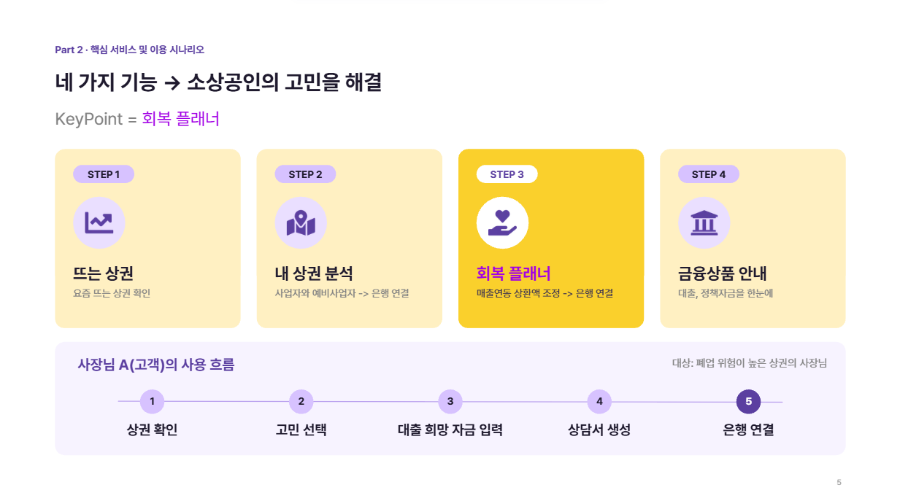
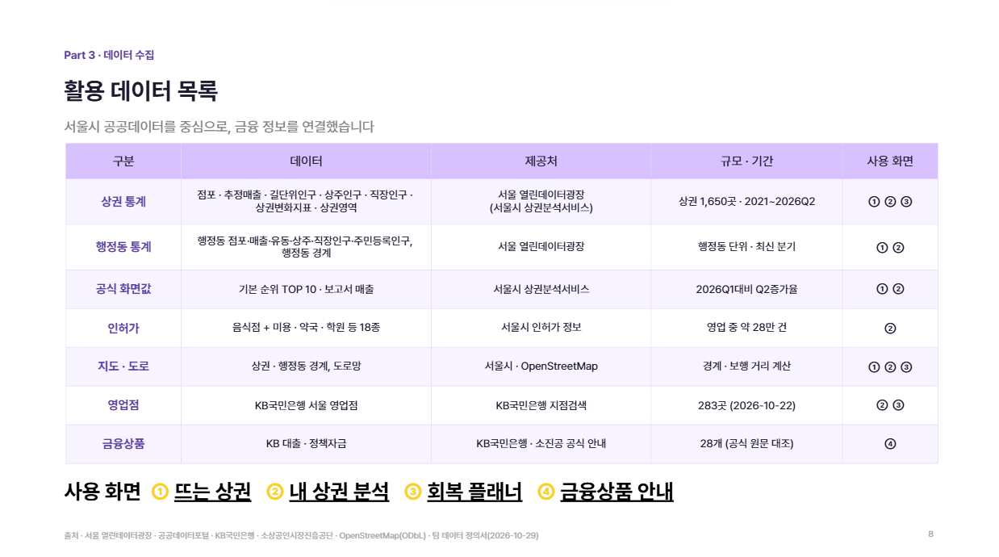
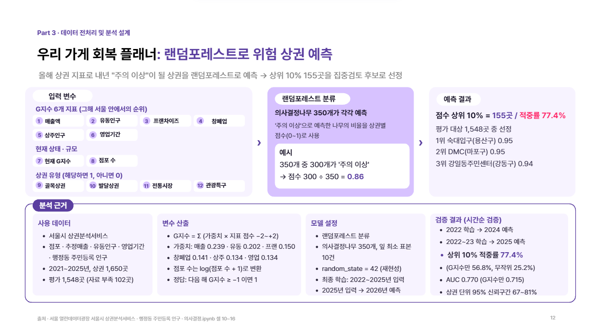
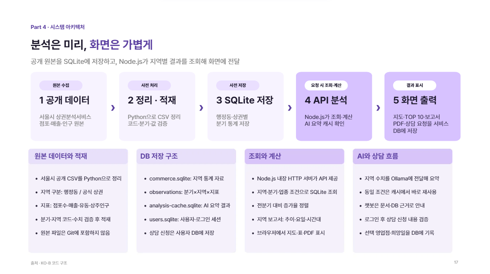
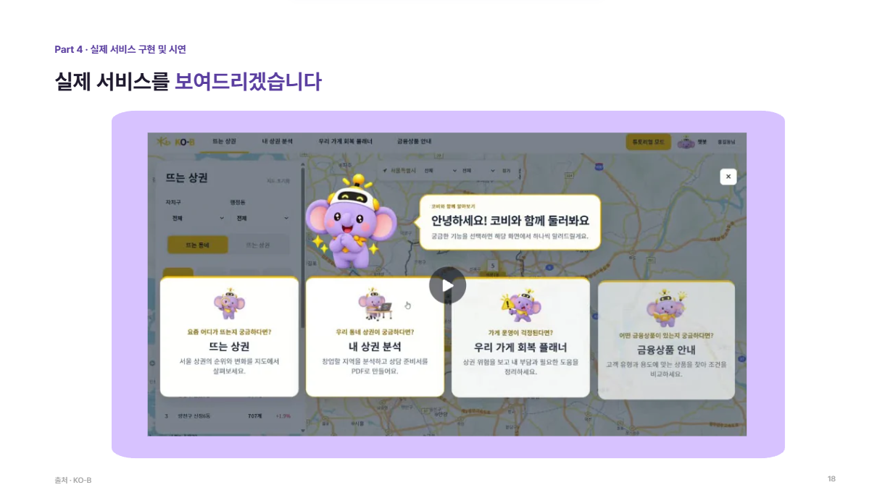
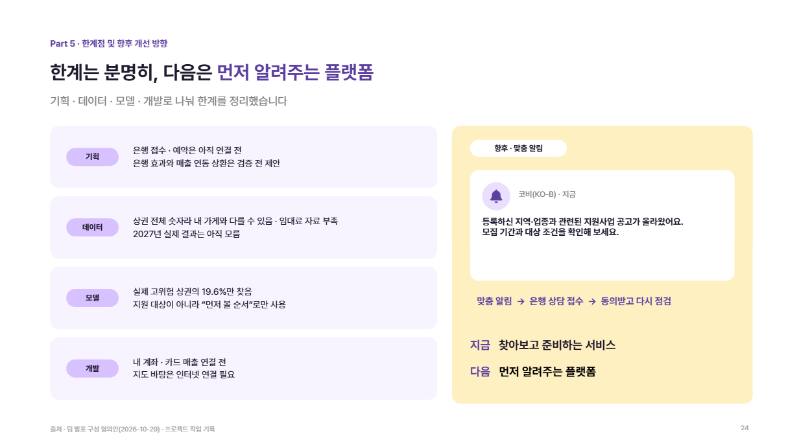

# KO-B

### 공개 상권 데이터를 지역 분석과 상담 준비로 연결하는 서비스

KO-B(코비)는 서울시 공개 자료를 지역 코드·분기·지표 단위에 맞춰 보여주고, 상권의 변화를 사장님의 다음 행동과 연결하려는 프로젝트입니다. **우리 동네 확인 → 갚을 돈 계산 → 은행 상담 준비**가 핵심 흐름입니다. 지역별 위험은 개별 사업자의 폐업 가능성이나 대출 자격을 뜻하지 않습니다.

> **현재 구현** · 뜨는 상권과 내 상권 분석, 카카오 지도·순위·보고서, 우리 가게 회복 플래너의 상권 위험 참고값·상담 준비 화면, 금융상품의 공개 조건 안내를 제공합니다. 로그인한 사용자의 상담 요청은 서비스 SQLite에 저장합니다. 별도의 ‘위험상권’ 서비스나 개인별 금융상품 추천 기능은 제공하지 않습니다. 은행 시스템으로의 실제 상담 접수·예약도 연결되어 있지 않습니다. 지역 통계로 개별 사업자의 신용도·대출 가능액을 판단하지 않습니다.

## 목차

1. [프로젝트 소개](#1-프로젝트-소개)
2. [팀 소개](#2-팀-소개)
3. [서비스 흐름과 구현 범위](#3-서비스-흐름과-구현-범위)
4. [데이터와 표시 기준](#4-데이터와-표시-기준)
5. [기술 스택과 프로젝트 구조](#5-기술-스택과-프로젝트-구조)
6. [로컬 실행](#6-로컬-실행)
7. [검증](#7-검증)
8. [트러블슈팅과 기술 전환](#8-트러블슈팅과-기술-전환)
9. [한계와 다음 작업](#9-한계와-다음-작업)
10. [관련 문서](#10-관련-문서)

## 1. 프로젝트 소개

과거 상권 지표만 제시하면 사용자가 복잡한 수치를 해석하고 다음 행동을 찾기 어렵습니다. 이 프로젝트는 점포수·추정매출·인구와 폐업 관련 자료를 근거로 **폐업 위험이 높은 상권**을 파악하고, 은행이 우선 조사하거나 상담을 제안할 지역을 검토하는 데 활용하려고 합니다. 지역 단위 분석 결과를 개별 사업자의 폐업 예측이나 여신 심사 결과로 사용하지 않습니다.

**상권 조회 → 회복 플래너에서 지역 위험 참고값과 경영 부담 확인 → 상담 준비**가 서비스 흐름입니다. 폐업 위험 분석은 회복 플래너 안에서 제공하며, 별도 위험상권 메뉴로 운영하지 않습니다. 상담 요청은 서비스 DB에 저장하지만 은행 업무 시스템과 연결되어 있지 않습니다.

### 누구를 위한 서비스인가

| 사용자 | 확인할 내용 | 다음 행동 |
| --- | --- | --- |
| 사업을 운영 중인 소상공인 | 내 지역의 점포·매출·인구 변화, 직접 입력한 경영 부담 | 지역 보고서를 읽고 상담에 필요한 정보를 정리 |
| 창업을 준비하는 사용자 | 후보 지역의 지표·경쟁·생활환경 | 후보 지역을 비교하고 공개 금융·지원 조건 확인 |
| 영업·상담 담당자 | 지역 단위의 위험 신호와 사용자가 준비한 상담서 | 추가 확인이 필요한 지역·질문을 검토. 현재 은행 업무 시스템과 자동 연동되지 않음 |

**판단의 단위:** 상권 분석은 지역 통계이고, 회복 플래너의 개인 금액은 사용자가 직접 입력한 값입니다. 이 둘을 합쳐 특정 사업자의 폐업 확률이나 대출 승인 가능성을 계산하지 않습니다.

## 2. 팀 소개

**TEAM BLEND · 2026년 10월 16일~11월 3일 개발**

| 팀원 | 역할 |
| --- | --- |
| 정지수 | 팀장 |
| 김채연 · 이준용 | 데이터 |
| 배정환 · 최황혁 | 기획 |
| 진희헌 | 개발 |

## 3. 서비스 흐름과 구현 범위

| 영역 | 현재 상태 | 실제 동작 |
| --- | --- | --- |
| 뜨는 상권 | 구현 | 행정동·공식 상권, 업종·분기·정렬 조건, TOP 10·카카오 지도·지역 보고서, PDF 저장 화면 |
| 내 상권 분석 · 사업 운영 | 구현 | 행정동·공식 상권, 분기·업종·지표 선택과 순위·카카오 지도·경영 진단 보고서를 한 화면에서 조회. 점포 위치·보행·반경 분석은 별도 화면에서 제공 |
| 내 상권 분석 · 창업 준비 | 구현 | 후보 지역의 순위·카카오 지도·보고서와 위치·반경·다각형 도구. 내 상권 분석에서 창업 준비 상황을 선택하고 전용 화면으로 이동 가능 |
| 우리 가게 회복 플래너 | 시연 구현 | 상권별 폐업 위험 예측값과 직접 입력한 경영 조건을 살펴보고 영업점 후보·상담 준비 자료를 확인. 로그인한 사용자의 상담 요청은 서비스 SQLite에 저장하며, 실제 은행 접수·예약은 아님 |
| 금융상품 안내 | 구현 | KB 상품·정책자금의 공개 조건과 출처를 조회. 개인별 적격성·적용금리 판정은 아님 |

**금융 정보의 범위:** 금융상품 안내는 공개 조건과 공식 출처를 보여줍니다. 금융 규제와 은행의 심사 권한을 고려해 개인별 상품 추천·대출 적격성 판정·적용금리 산정은 서비스 기능이나 개발 계획에 포함하지 않습니다.

### 화면별 입력과 결과

| 화면 | 사용자가 선택·입력하는 항목 | 화면에서 확인하는 결과 |
| --- | --- | --- |
| 뜨는 상권 | 행정동/공식 상권, 지표, 분기, 자치구, 업종, 정렬 조건 | TOP 10, 지도 위치·경계, 지역 종합의견과 5개 분석 탭, PDF |
| 내 상권 분석 | 사업 운영/창업 준비 상황, 지역 찾는 방법, 지표·상세 조건 | 지역 순위와 지도, 경영 진단 보고서, 위치·영역 분석 |
| 우리 가게 회복 플래너 | 관심 지역, 직접 입력한 경영 조건, 희망 영업점·상담일 | 부담 비교, 상담 준비 내용, 상담서 PDF, 서비스 DB 내 요청 기록 |
| 금융상품 안내 | 상품 종류와 공개 조건 | 대상·조건·출처. 실제 적용 여부는 별도 확인 |
| 코비 챗봇 | 사이트 사용법 또는 지역 통계 질문 | 안내 문서·SQLite 조회에 근거한 답변 |

**화면 흐름:** 뜨는 상권에서 지표·분기·업종별 순위를 비교하고, 지도에서 지역을 선택해 보고서의 추이와 세부 근거를 확인합니다. 내 상권 분석에서는 현재 사업자와 예비 창업자의 상황별 화면을 사용합니다. 회복 플래너에서는 사용자가 직접 입력한 조건으로 부담을 점검하고 상담서를 작성합니다. 금융상품 안내는 공개 조건을 확인하는 마지막 참고 단계입니다.



*발표의 ‘은행 연결’은 제안한 흐름입니다. 현재 앱은 상담 요청을 서비스 DB에 저장하며 은행으로 전송하지 않습니다.*

| 상담 단계 | 현재 처리 | 제공하지 않는 처리 |
| --- | --- | --- |
| 로그인 | 로컬 사용자·세션을 `data/users.sqlite`에서 확인 | 은행 고객 인증 |
| 상담서 작성 | 사용자의 입력과 선택 지역·영업점·희망일로 PDF 생성 | 자동 대출 심사 |
| 영업점 상담 보내기 | 입력값을 검증하고 서비스 DB의 `consultation_requests`에 기록 | 은행 시스템 전송, 예약 확정, 담당자 알림 |

지역 보고서는 적재된 SQLite를 조회하고 같은 지역·분기의 반복 요청은 서버 메모리에서 재사용합니다. 뜨는 상권의 종합의견은 원본 수치 요약을 먼저 표시하고, Ollama 생성 결과를 `data/analysis-cache.sqlite`에 저장해 다음 조회와 서버 재시작 후에 재사용합니다. 처음 조회하는 지역의 AI 생성에는 시간이 걸릴 수 있습니다.

코비 챗봇은 사이트 안내 질문에 허용된 Markdown 문서를 검색하고, 지역 질문에는 SQLite 원본 통계를 조회합니다. Ollama는 선택형 답변 생성에 사용하며, 모델이 응답하지 않으면 자료 기반 안내를 사용합니다. AI 답변은 지역 수치나 금융 자격을 임의로 확정하는 근거가 아닙니다.

금융상품 안내는 공개 조건을 비교하는 화면입니다. 상권별 위험 신호는 상담 준비에 참고할 수 있지만, 특정 상품을 개인에게 권하거나 대출 가능 여부를 판단하지 않습니다.

## 4. 데이터와 표시 기준

```text
서울시 원본 ZIP·행정동 CSV → Python 적재 스크립트 → SQLite
                                                    ↓
브라우저 화면·지도·보고서 ← Node.js API ← 공식 확인값 + 공개 원본 계산값
```

| 자료 | 적용 기준 |
| --- | --- |
| 행정동 점포·매출·인구 | `kind='dong'`인 행정동 원본. 공식 상권 값을 합산해 행정동 값을 만들지 않음 |
| 공식 상권 지표 | 해당 상권 코드와 선택 분기·업종의 제공 범위 |
| 최신 기본 TOP 10 | 확인된 공식 순위 응답을 저장한 스냅샷을 우선 적용 |
| 다른 분기·상세조건 | 로컬 SQLite의 공개 원본을 조건별로 집계하고 계산값으로 표시 |
| 점포당 월평균 추정매출 | 확인된 공식 보고서 값이 있으면 그 값을 사용하고, 그 밖에는 분기 매출 ÷ 3개월 ÷ 해당 분기 점포수로 계산 |
| 유동인구 밀도 | 분석 면적을 확인한 경우에만 분기 유동인구 ÷ 면적(ha)으로 표시 |
| 주변 인허가 업소 | 좌표·선택 범위 기준의 별도 관측. 공식 점포수나 현재 영업 중인 경쟁 점포수와 구분 |

`commerce.sqlite`의 `observations`는 **분기·지역 종류·지표·지역 코드** 조합으로 값을 저장합니다. 보고서 상세 자료는 `report_details`와 `report_industries`에서 조회합니다. 행정동 직장인구는 별도 공개 자료의 지역 코드와 분기를 맞춰 사용하며, 원본에 없는 지역을 공식 상권 값으로 채우지 않습니다.

| 자료 처리 단계 | 실제 내용 | 확인할 점 |
| --- | --- | --- |
| 수집 | 서울시 상권별 ZIP, 행정동 CSV·경계, 별도 직장인구 자료 준비 | 자료의 제공 시점·출처·지역 단위 |
| 적재 | Python 스크립트가 원본 열을 정리하고 SQLite의 분기·지역·지표 행으로 저장 | 지역 코드·분기 형식과 중복·결측 |
| 보강 | 보고서 세부 열과 업종별 자료를 적재하고 공식 화면 확인값은 작은 JSON으로 별도 보관 | 공식값은 확인한 조건에만 적용 |
| 조회 | 선택 조건으로 DB를 읽고 추이·증가율·환산값 계산 | 행정동과 공식 상권, 총량과 밀도의 구분 |
| 표시 | 목록·지도·보고서·PDF에 단위와 출처를 함께 표시 | 결측을 0이나 다른 지역 값으로 채우지 않음 |



원본의 결측은 0으로 바꾸지 않습니다. 공개 지역 추정매출은 개별 가게의 실매출이 아닙니다. 자세한 사례는 [데이터 모델](docs/DATA-MODEL.md)과 [뜨는 상권 개발 기록](docs/RISING-AREA-DEVELOPMENT-NOTES.md)에 있습니다.

### 위험 상권 분석: 서비스 적용과 발표 실험의 구분

최종 발표 자료에는 여러 분석 방법이 등장합니다. **회복 플래너의 화면 순위에 연결된 결과와 발표에서 비교한 실험 결과는 서로 다릅니다.** 수치를 섞어 현재 서비스의 성능으로 설명하지 않습니다.

| 구분 | 실제 용도·방법 | 결과를 해석할 때 |
| --- | --- | --- |
| 회복 플래너 화면 | 2025년 상권 자료를 입력해 2027년 상권 폐업률을 추정한 **OLS 회귀** 산출물. 현재 폐업률, 점포 규모, 상권 유형을 사용 | 1,650곳 중 비교 가능한 1,548곳을 평가하고 상위 10%인 155곳을 우선 검토 후보로 표시. 자료 부족 102곳은 제외 |
| G지수 | 매출·인구·영업기간 등으로 상권 상태를 비교하는 참고 지표 | 화면 위험 순위에 가산점으로 더하지 않음 |
| K-평균 군집 | 변화가 비슷한 상권을 4개 군집으로 나누는 탐색 분석 | 위험 군집의 반복·신규·지속 여부를 설명하는 별도 분석 |
| 랜덤포레스트 | 발표 자료에서 상권별 ‘주의 이상’ 분류를 비교한 **별도 실험** | 발표 검증의 상위 10% 적중률 77.4%를 현재 회복 플래너의 OLS 성능으로 표시하지 않음 |

화면에 연결된 OLS의 과거 시점 검증에서 **2년 뒤 상위 10% 적중률은 약 49.0%, 실제 고위험 상권 포착률은 약 19.6%**였습니다. 검증의 ‘고위험’은 목표 연도 폐업률 상위 25%를 뜻합니다. 2027년 실제 결과는 아직 알 수 없으며, 이 값은 특정 사업자의 폐업 확률이 아닙니다. 재현 절차와 제외 기준은 [회복 플래너 분석 안내](frontend/pages/intended-owner/README.md)와 [위험 산출 근거](frontend/pages/intended-owner/CLOSURE-RISK.md)에 있습니다.



*이 그림은 발표의 랜덤포레스트 실험입니다. 현재 회복 플래너 화면의 위험 순위는 위에서 설명한 OLS 산출물을 사용합니다.*

## 5. 기술 스택과 프로젝트 구조

      

Node.js 내장 HTTP 서버와 SQLite 모듈이 API·정적 파일을 제공합니다. 프런트엔드는 별도 빌드 도구 없이 HTML·CSS·JavaScript로 실행됩니다. Python은 서울시 원본 자료를 준비·적재할 때 사용하며 **웹 앱 런타임에는 사용하지 않습니다.** Ollama는 선택형 종합의견과 사이트 안내 챗봇에 사용합니다. 챗봇은 지역 질문에 SQLite 원본 통계를 조회하고, 사용법 질문에는 허용된 Markdown 안내 문서를 검색합니다. Ollama가 꺼져 있어도 지역 수치와 짧은 문서 안내는 표시합니다.

| 저장소·서버 | 저장하거나 처리하는 내용 | 반복 조회 시 동작 |
| --- | --- | --- |
| `data/commerce.sqlite` | 행정동·공식 상권의 분기 통계와 보고서 상세 | Node.js가 조건별 조회, 보고서는 서버 메모리에서 재사용 |
| `data/analysis-cache.sqlite` | Ollama가 생성한 지역 종합의견 | 같은 지역·분기·모델 조건이면 저장된 결과 사용 |
| `data/users.sqlite` | 사용자, 로그인 세션, 상담 요청 | 사용자 인증 후 요청 기록 조회·저장 |
| `backend/server.js` | 정적 화면과 순위·보고서·분석·인증·상담 API | 브라우저가 필요한 조건으로 요청 |

### 요청이 처리되는 순서

1. 브라우저가 선택한 지역 종류(`dong`/`area`), 코드, 분기와 업종을 API에 전달합니다.
2. Node.js 서버가 조회 조건을 검증하고 `commerce.sqlite`의 같은 공간·시점 자료를 읽습니다.
3. 순위는 확인된 공식 기본 순위의 적용 범위를 먼저 살피고, 그 밖의 조건은 공개 원본에서 계산합니다. 지역 보고서는 점포·매출·인구의 분기 추이와 세부 열을 조합합니다.
4. 브라우저가 목록·지도 배지·보고서에 동일한 지역 코드와 분기를 사용합니다. PDF는 화면의 보고서·상담서 내용을 저장합니다.
5. AI 종합의견을 요청하면 저장된 결과를 먼저 확인하고, 없을 때 Ollama를 호출합니다. 로그인한 사용자의 상담 요청은 별도 사용자 DB에 기록합니다.

| 주요 API | 역할 |
| --- | --- |
| `/api/filters`, `/api/rankings` | 사용 가능한 조건과 지역 TOP 10 조회 |
| `/api/rising/summary`, `/api/rising/report` | 선택 지역 요약·상세 보고서 조회 |
| `/api/rising/analysis` | 지역 수치 기반 종합의견 및 AI 캐시 조회 |
| `/api/chat` | 코비 챗봇의 문서·지역 자료 기반 응답 |
| `/api/auth/*`, `/api/consultation-requests` | 로그인 상태와 상담 요청 저장 |



```text
kb-bridge-final-project/
├── package.json                  ① 실행·검증 명령
├── backend/                      ② Node.js API·정적 파일 서버
│   ├── server/                      데이터 조회·분석·환경 설정
│   └── scripts/                     Python 원본 적재·공식 순위 동기화
├── frontend/                     ③ 브라우저 화면과 공용 자산
│   ├── pages/                       뜨는 상권·내 상권·회복 플래너·금융상품 안내
│   ├── shared/                      지도·금융 데이터·폰트·브랜드 자산
│   └── styles.css                   공용 화면 스타일
├── data/                         ④ 공개 원본, 생성 SQLite·경계, 공식 확인값
├── tests/                        ⑤ API 데이터·공개 경로 회귀 검사
└── docs/                         ⑥ 설계·트러블슈팅·발표 이미지
```

`data/raw/`의 실행용 원본 ZIP·CSV, 생성 DB, `.env`와 개인 입력 자료는 Git에 올리지 않습니다. 다만 재현을 위해 `frontend/pages/intended-owner/analysis/raw/`에 별도로 동봉한 공개 자료 사본과 금융상품 출처 CSV는 저장소에 포함되어 있습니다. 두 위치의 용도를 구분해야 합니다. 화면·API·자료 흐름은 [아키텍처](docs/ARCHITECTURE.md)에 정리했습니다.

### GitHub의 Jupyter Notebook 언어 비율

GitHub 화면에 표시됐던 **Jupyter Notebook 92.9%**는 이 웹 앱의 실행 언어 비율이 아닙니다. 저장소에 포함된 연구용 `frontend/pages/intended-owner/analysis/sources/의사결정.ipynb` 한 파일이 약 **8.4 MB**이고, 그 안의 코드 셀뿐 아니라 실행 결과·그래프가 JSON으로 저장되어 파일 크기가 큽니다. 확인 시 코드 셀 23개, Markdown 셀 15개였으며 실행 결과 JSON만 약 640만 문자였습니다. GitHub의 언어 통계는 저장된 파일의 크기와 분류에 영향을 받습니다. 현재 서비스 화면과 API는 JavaScript·Node.js로 실행하고, Python은 공개 원본 준비·적재와 분석 재현에 사용합니다.

## 6. 로컬 실행

**필요 환경:** Node.js 22.13 이상. 공개 원본 자료를 처음부터 적재할 때만 Python 3이 필요합니다.

```powershell
Copy-Item .env.example .env
npm run dev
```

브라우저에서 `http://localhost:5173`을 엽니다. 개발 서버는 `node --watch backend/server.js`로 실행되며, 한 번만 실행할 때는 `npm start`를 사용합니다. 브라우저 주소 `/pages/`와 `/shared/`는 유지됩니다. 이 프로젝트 루트에는 `package.json`이 있으므로 이 위치에서 명령을 실행하세요.



**새로 Git clone한 폴더에는 `data/commerce.sqlite`와 지도 경계 GeoJSON이 없습니다.** 바로 실행하려면 기존 개발 PC에서 `commerce.sqlite`, `commerce.geojson`, `commerce-dong.geojson` 세 파일을 별도로 받아 `data/`에 넣습니다. 사용자·상담 기록이 담길 수 있는 `users.sqlite`와 API 키가 담긴 `.env`는 전달하지 않습니다. 파일별 위치와 실행 순서는 [데이터 안내](data/README.md)에 있습니다.

DB를 전달받지 않았다면 서울시 상권별 원본 ZIP을 **별도로 확보**해 `data/raw/seoul_public_data.zip`에 둔 뒤 Python 3으로 다음 명령을 실행합니다. `fetch:dong`은 행정동 자료만 내려받으며 상권 ZIP을 만들어 주지 않습니다.

```powershell
npm run fetch:dong
npm run import:raw
npm run import:details
```

`.env`의 `DB_PATH` 기본값은 `data/commerce.sqlite`입니다. 카카오 지도 화면을 사용하려면 `KAKAO_MAP_JAVASCRIPT_KEY`를 설정하고 카카오 개발자 콘솔에 `http://localhost:5173`을 허용 도메인으로 등록합니다. 도보 경로에는 `KAKAO_REST_API_KEY`가 별도로 필요합니다. `OLLAMA_BASE_URL`·`OLLAMA_MODEL`은 선택형 AI 의견과 문서 안내 챗봇에 사용합니다. 로컬 Ollama에서 모델을 준비하지 않으면 챗봇은 관련 문서 내용을 표시합니다. 실제 키는 `.env`에만 보관합니다.

## 7. 검증

```powershell
npm test
```

현재 자동 검사는 공식 순위와 로컬 계산값, 점포당 월평균 매출, 유동인구 밀도, 상세조건의 정렬을 확인합니다. DB가 없으면 자료 의존 검사는 일부 건너뛸 수 있습니다. 지도 배지·경계 위치, 좁은 화면과 PDF 출력은 실제 브라우저에서 별도로 확인합니다. [검증 안내](docs/TESTING.md)에 절차를 적었습니다.

## 8. 트러블슈팅과 기술 전환

초기 Node.js 구현과 Python·Streamlit 구현을 **둘 다 직접 만들고 비교했습니다.** Streamlit에서는 Python 지표를 화면에 빠르게 연결했지만, 지도 위 패널의 정확한 위치와 크기, 복합 필터의 적용 상태, 지도 클릭과 보고서 상태를 맞추기 위해 내부 요소 대상 CSS·별도 지도 컴포넌트·`session_state`·재실행 처리가 늘었습니다. Node.js 구현에서는 브라우저 이벤트, 패널 스타일, API 요청 시점을 직접 제어할 수 있어 이 프로젝트의 지도 중심 화면에 맞았습니다.

| 직면한 문제 | Streamlit에서 직접 처리한 방식 | Node.js에서 직접 처리한 방식 |
| --- | --- | --- |
| 지도와 좌우 패널 배치 | Streamlit 컨테이너와 내부 요소에 별도 CSS를 적용해 크기·고정 위치를 맞춤 | HTML 구조와 CSS에서 지도·패널 위치를 직접 정의 |
| 필터·지도·보고서 상태 | `session_state`의 임시 선택값과 `st.rerun()`으로 갱신 순서를 조정 | JavaScript에서 임시/적용 조건을 나누고 필요한 시점에 API 요청 |
| 지도 클릭 후 보고서 열기 | 사용자 지도 컴포넌트의 선택값을 Python 페이지 상태로 전달 | 브라우저의 지도 이벤트에서 지역 코드로 보고서 API 호출 |
| 실행 명령 | `python -m streamlit run app.py`; `package.json`이 없어 `npm run dev` 실패 | 루트 `package.json`이 `backend/server.js`를 실행하므로 저장소 루트에서 `npm run dev` 실행 |

데이터 단위·공간 범위가 다른 문제는 프레임워크를 바꿔도 그대로 중요합니다. 자세한 증상, 코드 근거와 남은 검증 항목은 [기술 전환 기록](docs/TROUBLESHOOTING.md)에 있습니다.

### 최근 데이터·기능 문제

| 증상 | 원인 또는 확인 사항 | 적용한 처리와 남은 경계 |
| --- | --- | --- |
| 보고서 매출액이 `자료 부족`으로 표시 | 공식 화면 확인값과 원본 세부 자료의 분기·지역·업종 범위가 달랐음 | 같은 범위의 원본과 공식 확인값을 구분해 조회. 일부 업종의 자료만 있으면 전체 값으로 단정하지 않음 |
| 유동·상주·직장인구가 `자료 없음`으로 표시 | 행정동과 공식 상권의 지역 코드·관측 단위가 다르고, 직장인구는 별도 원본에 있음 | 행정동 원본과 직장인구 가공본을 코드·분기로 연결. 원본 결측은 그대로 표시 |
| 요일별 유동인구의 수치·비율이 어색함 | 요일별 세부 열의 집계 범위와 분기 총량의 관계 확인이 필요했음 | 원본 세부 열 기준으로 집계·표시하고 합계와 비율을 대조 |
| 지역 선택 후 지도·순위·보고서 불일치 | 선택 상태와 API 요청의 지역 코드·분기가 달라질 수 있음 | 목록·지도 배지·보고서에 동일한 코드와 조건을 사용해 검증 |
| 지역 분석·AI 의견이 느림 | 반복 DB 조회와 첫 Ollama 생성 시간 | 보고서 메모리 캐시와 AI 결과 SQLite 캐시. 첫 생성은 여전히 모델 실행 시간이 필요 |
| 상담 보내기 후 실제 은행 예약이 없음 | 서비스 DB와 은행 접수 시스템은 별개 | 로그인 요청을 로컬 DB에 기록. 실제 전송·예약·알림은 아직 미연동 |
| 지도가 보이지 않음 | 카카오 JavaScript 키 또는 허용 도메인 누락 | `.env`와 카카오 개발자 콘솔의 `http://localhost:5173` 설정 확인 |

## 9. 한계와 다음 작업

| 구분 | 현재 한계 | 다음 검증·개선 |
| --- | --- | --- |
| 기획·은행 연동 | 상담 요청은 서비스 DB에만 저장. 실제 은행 접수·예약, 고객 확인, 사후관리와 연결되지 않음 | 고객 동의와 전달 범위, 은행 업무 시스템 연동, 개인정보 운영 체계 검토 |
| 데이터 | 상권 전체 통계는 개별 가게와 다를 수 있고, 계약 임대료·공실·개별 매출 자료가 부족함 | 임대료와 장기 시계열을 확보한 뒤 젠트리피케이션·상환 부담 가설 검증 |
| 모델 | 화면에 연결된 과거 검증의 고위험 포착률이 약 19.6%. 2027년 실제 결과는 아직 없음 | 기준 연도별 재검증, 재개발·철거 상권 대조, 예측의 적용 범위 공개 |
| 금융 | 매출 연동 상환과 은행의 상담 시간 절감 효과는 제안·가설 | 공개 안내의 최신성 확인과 상담 시간·재방문·연체 변화 검증. 상품 적격성은 은행이 별도로 확인 |
| 서비스 운영 | 내 계좌·카드 매출은 연결되지 않았고 지도 바탕은 인터넷 연결에 의존 | 동의 기반 데이터 연결, 장애 대응, 모바일 화면·원본 갱신 절차 개선 |

위험 상권 후보는 **먼저 살펴볼 순서**입니다. 지원 대상 확정, 개인의 위험 등급, 대출 심사·승인, 실제 은행 접수로 표현하지 않습니다.



## 10. 관련 문서

README에 있던 이전 발표 스크린샷을 제거하고, 사용자가 제공한 **최종 발표 자료의 화면 6개**를 각 설명 옆에 배치했습니다. 발표의 실험·향후 제안과 현재 웹 앱의 실제 구현은 캡션과 본문에서 구분합니다.

| 문서 | 내용 |
| --- | --- |
| [아키텍처](docs/ARCHITECTURE.md) | Node.js 화면·API·SQLite·적재 흐름 |
| [데이터 모델](docs/DATA-MODEL.md) | 원본·공식 확인값·계산값의 기준 |
| [Streamlit 화면 대응](docs/MIGRATION-PARITY.md) | 이전 화면의 데이터·기능과 Node.js 화면의 대응 관계 |
| [뜨는 상권 개발 기록](docs/RISING-AREA-DEVELOPMENT-NOTES.md) | 수치·순위·지도 문제와 해결 사례 |
| [기술 전환 기록](docs/TROUBLESHOOTING.md) | 두 구현의 구체적인 문제와 비교 |
| [데이터 안내](data/README.md) | 공개 자료 준비·적재·비공개 경로 |
| [검증 안내](docs/TESTING.md) | 자동 검사와 브라우저 확인 |
| [협업 규칙](docs/COLLABORATION.md) | 이슈·브랜치·PR 규칙 |
| [회복 플래너 분석 안내](frontend/pages/intended-owner/README.md) | 현재 화면에 연결된 위험 산출물과 재현 방법 |
