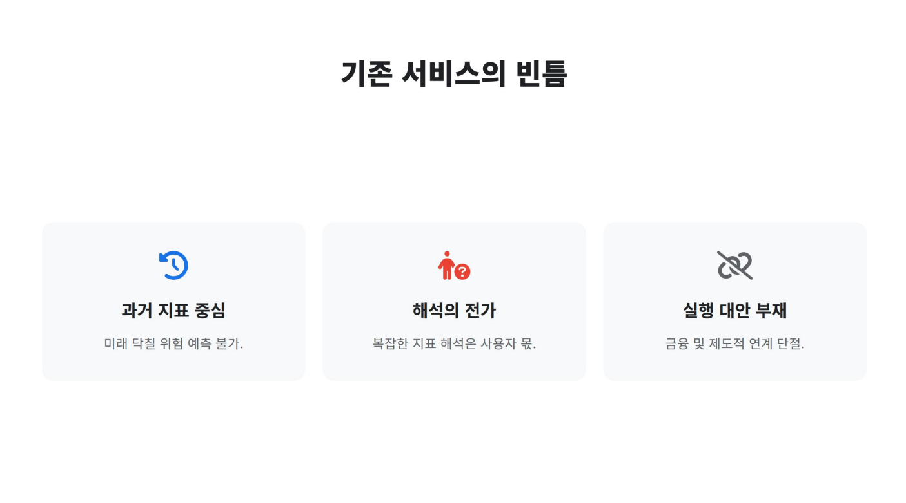
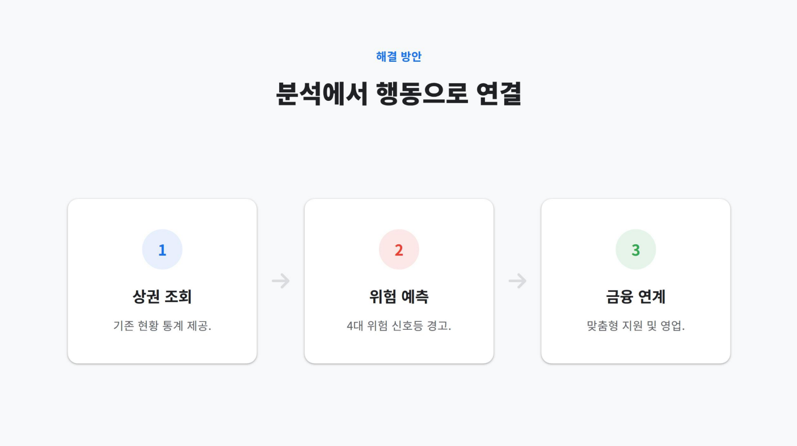
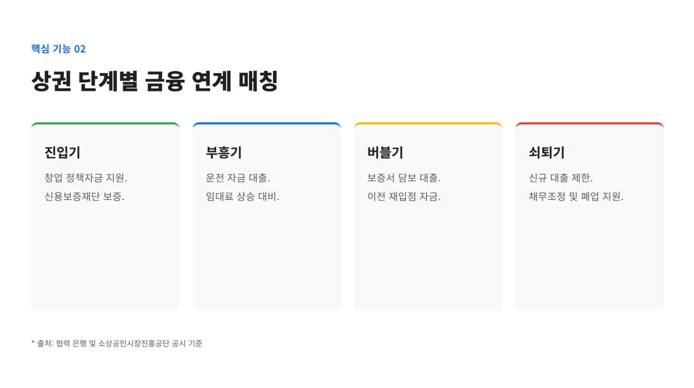

# KB 상권브릿지

### 폐업 위험이 높은 상권을 파악하고 영업·상담 준비에 활용하는 서비스

KB 상권브릿지는 서울시 공개 자료를 지역 코드·분기·지표 단위에 맞춰 보여주고, 폐업 위험이 높은 상권을 찾아 우선 살펴볼 지역을 정하는 데 도움을 주려는 프로젝트입니다. **상권 탐색 → 지역별 폐업 위험 확인 → 영업·상담 대상 검토 → 공개 금융·지원 정보 안내**를 목표 흐름으로 삼습니다. 지역별 위험은 개별 사업자의 폐업 가능성이나 대출 자격을 뜻하지 않습니다.

> **현재 구현** · 뜨는 상권과 내 상권 분석, 카카오 지도·순위·보고서, 회복 플래너의 상권별 폐업 위험 예측값·상담 준비 화면, 금융상품의 공개 조건 안내를 제공합니다. 별도 위험상권 메뉴의 진단 화면, 개인별 금융상품 추천과 실제 상담 접수는 개발 중입니다. 지역 통계와 시연 입력값으로 개별 사업자의 신용도·대출 가능액을 판단하지 않습니다.

## 목차

1. [프로젝트 소개](#1-프로젝트-소개)
2. [팀 소개](#2-팀-소개)
3. [서비스 흐름과 구현 범위](#3-서비스-흐름과-구현-범위)
4. [데이터와 표시 기준](#4-데이터와-표시-기준)
5. [기술 스택과 프로젝트 구조](#5-기술-스택과-프로젝트-구조)
6. [로컬 실행](#6-로컬-실행)
7. [검증](#7-검증)
8. [트러블슈팅과 기술 전환](#8-트러블슈팅과-기술-전환)
9. [개발 중인 기능](#9-개발-중인-기능)
10. [관련 문서](#10-관련-문서)

## 1. 프로젝트 소개

과거 상권 지표만 제시하면 사용자가 복잡한 수치를 해석하고 다음 행동을 찾기 어렵습니다. 이 프로젝트는 점포수·추정매출·인구와 폐업 관련 자료를 근거로 **폐업 위험이 높은 상권**을 파악하고, 은행이 우선 조사하거나 상담을 제안할 지역을 검토하는 데 활용하려고 합니다. 지역 단위 분석 결과를 개별 사업자의 폐업 예측이나 여신 심사 결과로 사용하지 않습니다.



**상권 조회 → 폐업 위험 확인 → 영업·상담 검토**는 목표 흐름입니다. 회복 플래너에 상권별 예측 자료가 연결되어 있지만, 별도 위험상권 화면과 실제 영업·상담 시스템 연동은 아직 개발 중입니다.



## 2. 팀 소개

| 정지수 | 이준용 | 배정환 | 김채연 | 진희헌 |
| :---: | :---: | :---: | :---: | :---: |

## 3. 서비스 흐름과 구현 범위

| 영역 | 현재 상태 | 실제 동작 |
| --- | --- | --- |
| 뜨는 상권 | 구현 | 행정동·공식 상권, 업종·분기·정렬 조건, TOP 10·카카오 지도·지역 보고서, PDF 저장 화면 |
| 내 상권 분석 · 사업 운영 | 구현 | 행정동·공식 상권, 분기·업종·지표 선택과 순위·카카오 지도·경영 진단 보고서를 한 화면에서 조회. 점포 위치·보행·반경 분석은 별도 화면에서 제공 |
| 내 상권 분석 · 창업 준비 | 구현 | 후보 지역의 순위·카카오 지도·보고서와 위치·반경·다각형 도구. 내 상권 분석에서 창업 준비 상황을 선택하고 전용 화면으로 이동 가능 |
| 우리 가게 회복 플래너 | 시연 구현 | 상권별 폐업 위험 예측값과 직접 입력한 경영 조건을 살펴보고 영업점 후보·상담 준비 자료를 확인. 실제 접수·예약은 아님 |
| 위험상권 | 개발 중 | 폐업 위험이 높은 상권의 선정 기준·근거·검증 결과를 별도 화면에서 설명하는 기능을 개발 중. 현재 메뉴는 안내 화면 |
| 금융상품 안내 | 구현 | KB 상품·정책자금의 공개 조건과 출처를 조회. 개인별 적격성·적용금리 판정은 아님 |
| 금융 상품 추천 | 개발 중 | 지역 위험과 사업자 상황을 고려한 개별 추천·적격성 검증은 아직 제공하지 않음 |

금융상품 안내는 공개 조건을 비교하는 화면입니다. 상권별 폐업 위험을 은행의 우선 조사·상담 대상 검토에 활용하는 방향이며, 실제 상품 추천이나 상담 접수로 연결하려면 별도의 자격 확인과 시스템 연동이 필요합니다. 아래 이미지는 초기 금융 연계 구상으로, 현재 제공하는 적격성 판단 결과가 아닙니다.



## 4. 데이터와 표시 기준

```text
서울시 원본 ZIP·행정동 CSV → Python 적재 스크립트 → SQLite
                                                    ↓
브라우저 화면·지도·보고서 ← Node.js API ← 공식 확인값 + 공개 원본 계산값
```

| 자료 | 적용 기준 |
| --- | --- |
| 행정동 점포·매출·인구 | `kind='dong'`인 행정동 원본. 공식 상권 값을 합산해 행정동 값을 만들지 않음 |
| 공식 상권 지표 | 해당 상권 코드와 선택 분기·업종의 제공 범위 |
| 최신 기본 TOP 10 | 확인된 공식 순위 응답을 저장한 스냅샷을 우선 적용 |
| 다른 분기·상세조건 | 로컬 SQLite의 공개 원본을 조건별로 집계하고 계산값으로 표시 |
| 점포당 월평균 추정매출 | 확인된 공식 보고서 값이 있으면 그 값을 사용하고, 그 밖에는 분기 매출 ÷ 3개월 ÷ 해당 분기 점포수로 계산 |
| 유동인구 밀도 | 분석 면적을 확인한 경우에만 분기 유동인구 ÷ 면적(ha)으로 표시 |
| 주변 인허가 업소 | 좌표·선택 범위 기준의 별도 관측. 공식 점포수나 현재 영업 중인 경쟁 점포수와 구분 |

원본의 결측은 0으로 바꾸지 않습니다. 공개 지역 추정매출은 개별 가게의 실매출이 아닙니다. 자세한 사례는 [데이터 모델](docs/DATA-MODEL.md)과 [뜨는 상권 개발 기록](docs/RISING-AREA-DEVELOPMENT-NOTES.md)에 있습니다.

## 5. 기술 스택과 프로젝트 구조

      

Node.js 내장 HTTP 서버와 SQLite 모듈이 API·정적 파일을 제공합니다. 프런트엔드는 별도 빌드 도구 없이 HTML·CSS·JavaScript로 실행됩니다. Python은 서울시 원본 자료를 준비·적재할 때 사용하며 **웹 앱 런타임에는 사용하지 않습니다.** Ollama는 선택형 종합의견 생성에 사용하고 실패 시 수치 기반 요약을 표시합니다.

```text
kb-bridge-final-project/
├── package.json                  ① 실행·검증 명령
├── backend/                      ② Node.js API·정적 파일 서버
│   ├── server/                      데이터 조회·분석·환경 설정
│   └── scripts/                     Python 원본 적재·공식 순위 동기화
├── frontend/                     ③ 브라우저 화면과 공용 자산
│   ├── pages/                       뜨는 상권·내 상권·회복 플래너·금융상품 안내
│   ├── shared/                      지도·금융 데이터·폰트·브랜드 자산
│   └── styles.css                   공용 화면 스타일
├── data/                         ④ 공개 원본, 생성 SQLite·경계, 공식 확인값
├── tests/                        ⑤ API 데이터·공개 경로 회귀 검사
└── docs/                         ⑥ 설계·트러블슈팅·발표 이미지
```

생성 DB와 원본 ZIP·CSV, `.env`는 Git에 올리지 않습니다. 화면·API·자료 흐름은 [아키텍처](docs/ARCHITECTURE.md)에 정리했습니다.

## 6. 로컬 실행

**필요 환경:** Node.js 22.13 이상. 공개 원본 자료를 처음부터 적재할 때만 Python 3이 필요합니다.

```powershell
Copy-Item .env.example .env
npm run dev
```

브라우저에서 `http://localhost:5173`을 엽니다. 개발 서버는 `node --watch backend/server.js`로 실행되며, 한 번만 실행할 때는 `npm start`를 사용합니다. 브라우저 주소 `/pages/`와 `/shared/`는 유지됩니다. 이 프로젝트 루트에는 `package.json`이 있으므로 이 위치에서 명령을 실행하세요.

로컬 DB `data/commerce.sqlite`가 없는 새 복제본에서는 원본 ZIP을 `data/raw/seoul_public_data.zip`에 놓고 행정동 CSV·경계를 `data/raw/dong/`에 준비한 뒤 다음 명령으로 적재합니다. 원본 수집 조건은 [데이터 안내](data/README.md)를 확인하세요.

```powershell
npm run fetch:dong
npm run import:raw
```

`.env`의 `DB_PATH` 기본값은 `data/commerce.sqlite`입니다. 모든 지도 화면에 `KAKAO_MAP_JAVASCRIPT_KEY`가 필요합니다. 카카오 개발자 설정에 로컬 도메인 `http://localhost:5173`을 등록합니다. `SEOUL_API_KEY`는 공개 자료 수집에, `OLLAMA_BASE_URL`·`OLLAMA_MODEL`은 선택형 AI 의견에 사용합니다. 실제 키는 `.env`에만 보관합니다.

## 7. 검증

```powershell
npm test
```

현재 자동 검사는 공식 순위와 로컬 계산값, 점포당 월평균 매출, 유동인구 밀도, 상세조건의 정렬을 확인합니다. DB가 없으면 자료 의존 검사는 일부 건너뛸 수 있습니다. 지도 배지·경계 위치, 좁은 화면과 PDF 출력은 실제 브라우저에서 별도로 확인합니다. [검증 안내](docs/TESTING.md)에 절차를 적었습니다.

## 8. 트러블슈팅과 기술 전환

초기 Node.js 구현과 Python·Streamlit 구현을 **둘 다 직접 만들고 비교했습니다.** Streamlit에서는 Python 지표를 화면에 빠르게 연결했지만, 지도 위 패널의 정확한 위치와 크기, 복합 필터의 적용 상태, 지도 클릭과 보고서 상태를 맞추기 위해 내부 요소 대상 CSS·별도 지도 컴포넌트·`session_state`·재실행 처리가 늘었습니다. Node.js 구현에서는 브라우저 이벤트, 패널 스타일, API 요청 시점을 직접 제어할 수 있어 이 프로젝트의 지도 중심 화면에 맞았습니다.

| 직면한 문제 | Streamlit에서 직접 처리한 방식 | Node.js에서 직접 처리한 방식 |
| --- | --- | --- |
| 지도와 좌우 패널 배치 | Streamlit 컨테이너와 내부 요소에 별도 CSS를 적용해 크기·고정 위치를 맞춤 | HTML 구조와 CSS에서 지도·패널 위치를 직접 정의 |
| 필터·지도·보고서 상태 | `session_state`의 임시 선택값과 `st.rerun()`으로 갱신 순서를 조정 | JavaScript에서 임시/적용 조건을 나누고 필요한 시점에 API 요청 |
| 지도 클릭 후 보고서 열기 | 사용자 지도 컴포넌트의 선택값을 Python 페이지 상태로 전달 | 브라우저의 지도 이벤트에서 지역 코드로 보고서 API 호출 |
| 실행 명령 | `python -m streamlit run app.py`; `package.json`이 없어 `npm run dev` 실패 | 루트 `package.json`이 `backend/server.js`를 실행하므로 저장소 루트에서 `npm run dev` 실행 |

데이터 단위·공간 범위가 다른 문제는 프레임워크를 바꿔도 그대로 중요합니다. 자세한 증상, 코드 근거와 남은 검증 항목은 [기술 전환 기록](docs/TROUBLESHOOTING.md)에 있습니다.

## 9. 개발 중인 기능

- 상권별 폐업 위험의 선정 기준·예측 성능·한계를 별도 위험상권 화면에서 설명
- 위험상권을 영업 우선 조사·상담 준비 흐름과 연결하고, 금융상품의 최신 조건·적격성은 별도로 검증
- 실제 로그인·상담 접수·예약 및 개인정보 처리 체계
- 현재 사업자·예비 창업자 화면을 한 메뉴에서 이동하는 흐름과 모바일 배치 개선

현재 안내 화면이나 상담 시연을 예측 결과·대출 심사·승인·실제 접수로 표현하지 않습니다.

## 10. 관련 문서

| 문서 | 내용 |
| --- | --- |
| [아키텍처](docs/ARCHITECTURE.md) | Node.js 화면·API·SQLite·적재 흐름 |
| [데이터 모델](docs/DATA-MODEL.md) | 원본·공식 확인값·계산값의 기준 |
| [Streamlit 화면 대응](docs/MIGRATION-PARITY.md) | 이전 화면의 데이터·기능과 Node.js 화면의 대응 관계 |
| [뜨는 상권 개발 기록](docs/RISING-AREA-DEVELOPMENT-NOTES.md) | 수치·순위·지도 문제와 해결 사례 |
| [기술 전환 기록](docs/TROUBLESHOOTING.md) | 두 구현의 구체적인 문제와 비교 |
| [데이터 안내](data/README.md) | 공개 자료 준비·적재·비공개 경로 |
| [검증 안내](docs/TESTING.md) | 자동 검사와 브라우저 확인 |
| [협업 규칙](docs/COLLABORATION.md) | 이슈·브랜치·PR 규칙 |
