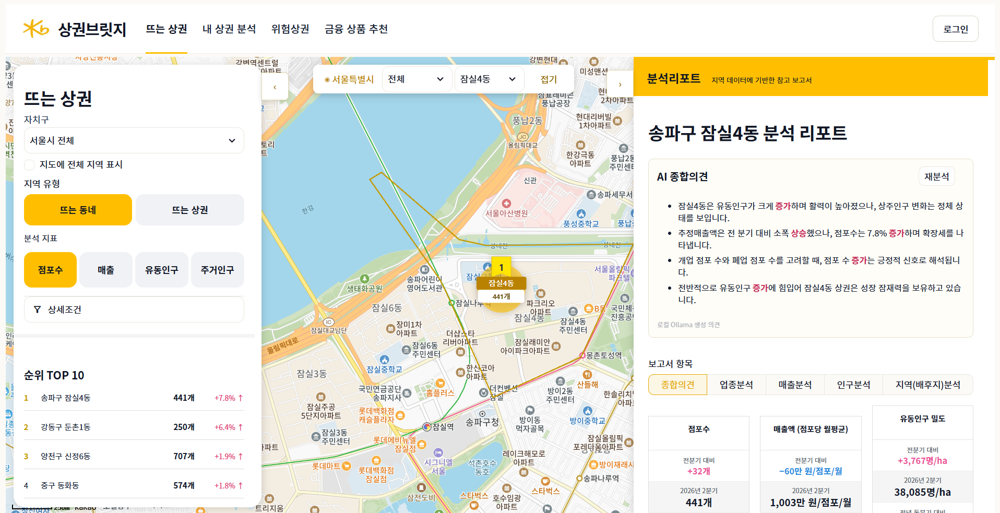
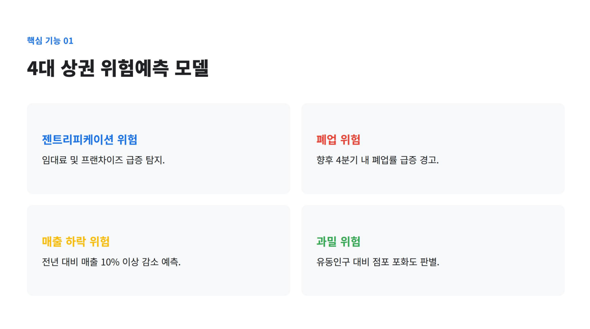
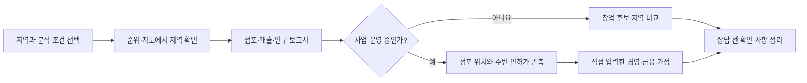

# KB 상권브릿지

### 위험 상권을 파악하고 필요한 금융·정책 지원으로 연결하는 소상공인 의사결정 지원 서비스

KB 상권브릿지는 서울시 공개 상권 자료로 지역 변화를 살펴보고, 위험 신호를 파악해 소상공인의 상황에 맞는 금융 상품·정책 지원과 상담 경로를 제안하는 것을 목표로 합니다. **상권 탐색 → 내 상권 진단 → 위험 파악 → 금융·지원 방안 연결**을 하나의 흐름으로 개발하고 있습니다.

> **개발 현황** · 뜨는 상권과 내 상권 분석은 로컬 자료를 준비하면 실행할 수 있습니다. 위험 예측과 금융 상품 추천은 개발 중이며 현재 메뉴에는 안내 화면이 표시됩니다. 로그인과 상담 접수 연동도 개발 중입니다.



## 목차

1. [프로젝트 소개](#1-프로젝트-소개)
2. [팀 소개](#2-팀-소개)
3. [문제 정의와 기획 방향](#3-문제-정의와-기획-방향)
4. [사용자와 이용 흐름](#4-사용자와-이용-흐름)
5. [화면별 기능](#5-화면별-기능)
6. [데이터와 지표 해석](#6-데이터와-지표-해석)
7. [기술 구성과 아키텍처](#7-기술-구성과-아키텍처)
8. [프로젝트 구조](#8-프로젝트-구조)
9. [로컬 실행 방법](#9-로컬-실행-방법)
10. [환경 설정](#10-환경-설정)
11. [검증 방법](#11-검증-방법)
12. [문제 해결](#12-문제-해결)
13. [개발 중인 기능과 다음 작업](#13-개발-중인-기능과-다음-작업)
14. [관련 문서](#14-관련-문서)

## 1. 프로젝트 소개

### 서비스가 다루는 질문

- 어느 동네 또는 공식 상권에서 점포수·매출·인구 지표가 변하고 있는가?
- 내가 운영하는 점포 주변의 인허가 관측과 공식 상권 통계는 각각 무엇을 보여주는가?
- 지역의 추정매출과 **내 가게의 실제 매출**을 어떻게 구분해 판단할 것인가?
- 월세·운영비·대출 상환액이 바뀌면 직접 입력한 현금흐름 가정은 어떻게 달라지는가?
- 위험 징후가 보이는 지역에서는 어떤 금융 상품·정책 지원과 상담 경로를 검토할 수 있는가?

프로젝트의 핵심은 **지역 지표를 근거와 함께 해석해 위험을 일찍 알아차리고, 사용자가 취할 수 있는 금융·지원 방안을 제시하는 것**입니다. 지역 통계와 개별 점포의 실제 재무 상태는 구분해 다룹니다.

### 현재 제공 범위

| 영역 | 상태 | 설명 |
| --- | --- | --- |
| 뜨는 상권 | 사용 가능 | 행정동·공식 상권 순위, 지도, 분기 비교, 5개 항목 보고서, PDF 내려받기 |
| 내 상권 분석 | 사용 가능 | 사업 운영·창업 준비 모드, 행정동·공식 상권 보고서, 위치 주변 인허가 관측 |
| 경영·금융 상담 준비 | 일부 사용 가능 | 직접 입력한 가정의 간이 현금흐름·분할상환 계산과 상담 준비 메모 |
| 위험상권 | 개발 중 | 위험 신호 분석과 검증된 예측 결과를 제공하는 기능을 개발 중. 현재는 안내 화면 |
| 금융 상품 추천 | 개발 중 | 위험 단계·사업 상황에 맞는 상품·정책 지원 정보 연결을 개발 중. 현재는 안내 화면 |
| 로그인·상담 접수 | 개발 중 | 사용자 인증과 실제 상담 접수·예약 연동을 개발 중 |

## 2. 팀 소개

| 이름 |
| --- |
| 정지수 |
| 이준용 |
| 배정환 |
| 김채연 |
| 진희헌 |

## 3. 문제 정의와 기획 방향

### 문제 정의

기존 상권 분석은 과거 지표 조회에 머무르기 쉽고, 복잡한 수치의 해석과 실행 방안을 사용자에게 맡깁니다. 상권의 변화가 임대료·경쟁·매출 부담으로 이어질 때 소상공인이 위험을 미리 파악하고 적절한 금융·정책 지원을 찾는 흐름이 필요합니다. 상권 지표는 공간 단위와 집계 기간이 달라 같은 범위의 자료끼리 비교해야 합니다.


*기획 발표 자료에서 정리한 문제의식입니다. 아래 발표 이미지는 서비스 방향을 설명하며 현재 구현 범위를 뜻하지 않습니다.*

### 기획 방향

1. **지역 변화 확인** — 점포수, 추정매출, 유동인구, 상주인구를 같은 지역 코드와 분기로 조회합니다.
2. **근거가 보이는 비교** — 현재 값, 전분기 변화, 자료 제공 범위와 원본·계산·공식 확인값의 차이를 표시합니다.
3. **내 상황과 연결** — 점포 위치와 주변 인허가 관측을 공식 상권 집계와 구분하고, 사업자가 직접 입력한 재무 가정만 계산합니다.
4. **위험 신호 파악** — 지역 변화와 사업 상황을 함께 살펴 젠트리피케이션, 폐업, 매출 하락, 과밀 위험을 진단하는 기능을 개발합니다.
5. **금융·정책 지원 연결** — 위험 단계와 자금 용도에 맞는 상품·지원 제도를 비교하고 상담 경로로 이어지는 기능을 개발합니다.


### 개발 중인 위험 진단과 금융 연결

발표 자료에서는 위험을 **젠트리피케이션·폐업·매출 하락·과밀**의 네 가지 신호로 나눴습니다. 예측 모델의 학습·평가, 위험 단계별 설명과 실제 화면 연결은 개발 중입니다. 검증 전에는 이 신호를 확정된 미래 예측으로 표시하지 않습니다.



금융 연계는 창업 준비, 운영, 확장, 쇠퇴 등 상황에 따라 정책자금·운전자금·보증·채무조정 같은 **검토 가능한 지원 유형**을 안내하는 방향입니다. 상품별 최신 요건과 사용자 적격성 확인, 실제 추천·상담 연결은 개발 중입니다. 발표 자료의 유형은 기획 예시이며 현재 제공 상품 목록이 아닙니다.


## 4. 사용자와 이용 흐름

| 사용자 | 시작점 | 현재 확인할 수 있는 내용 |
| --- | --- | --- |
| 지역을 살펴보는 사용자 | 뜨는 상권 | 지표별 TOP 10, 지도 배지, 지역 보고서, PDF |
| 사업 운영자 | 내 상권 분석 → 사업 운영 중 | 상호·주소 검색, 점포 주변 인허가 관측, 행정동·상권 보고서, 직접 입력한 금융 가정 |
| 예비 창업자 | 내 상권 분석 → 창업 준비 중 | 후보 지역·업종·분기 선택, 비교 순위, 지역 보고서 |



## 5. 화면별 기능

### 5.1 뜨는 상권

- **탐색 조건:** 뜨는 동네(행정동)와 뜨는 상권(공식 상권), 자치구, 분기, 업종, 비교 기간·정렬 기준을 선택합니다.
- **분석 지표:** 점포수, 매출, 유동인구, 주거인구 중 하나를 고르면 TOP 10과 지도 배지에 선택 지표의 값·단위를 표시합니다.
- **지도와 순위:** 서울 외곽선과 지역 경계를 참고해 지역을 선택하고 같은 지역 코드로 보고서를 엽니다. 카카오 지도 키가 없으면 대체 지도를 표시합니다.
- **지역 보고서:** 종합의견, 업종분석, 매출분석, 인구분석, 지역(배후지)분석의 5개 항목을 제공합니다. 점포수·개폐업·프랜차이즈 구성, 분기 추정매출, 점포당 월평균 추정매출, 유동인구 등을 자료가 있는 범위에서 보여줍니다.
- **그래프:** 분기별 값과 단위를 표시하는 정적 그래프를 사용합니다. 마우스 휠로 그래프가 확대·이동하지 않습니다.
- **AI 종합의견:** 사용자가 재분석을 요청할 때 로컬 Ollama에 확인된 보고서 수치를 전달합니다. 연결되지 않으면 데이터 기반 대체 요약을 표시합니다. 생성 문장은 원본 데이터 자체가 아닙니다.
- **내려받기:** 현재 보고서 항목 PDF와 5종 PDF를 묶은 ZIP을 내려받을 수 있습니다.

### 5.2 내 상권 분석

분석 대상과 공간 단위를 먼저 선택한 뒤 왼쪽 패널에서 조건을 바꾸고 오른쪽 보고서에서 같은 지역의 수치를 확인합니다.

**사업 운영 중**

1. 확보된 영업 인허가 자료에서 상호·주소로 점포 위치를 찾습니다. 검색 결과가 실제 소유 관계를 인증하지는 않습니다.
2. 업태와 300m·500m·1,000m 중 직선거리 반경을 선택해 주변 인허가 기록을 별도로 셉니다.
3. 행정동 전체 또는 공식 상권 전체의 점포·매출·인구 집계를 조회합니다. 위치 주변 인허가 건수를 공식 점포수에 합산하지 않습니다.
4. 필요한 경우 직접 입력한 월매출·비용·월세·상환액과 신규대출 가정으로 간이 현금흐름을 비교하고 상담 준비 메모를 저장합니다.

**창업 준비 중**

1. 지역·업종·분기와 점포수·매출·인구 지표를 선택합니다.
2. 비교 가능한 지역을 전분기 증가율 등 선택한 정렬 기준으로 살펴봅니다.
3. 후보 지역의 공식 집계와 업종·경쟁, 매출, 고객·인구, 주변 환경을 보고 창업 가정을 별도로 점검합니다.

**오른쪽 보고서 5개 탭**

| 탭 | 표시 내용 |
| --- | --- |
| 한눈에 보기 | 점포수, 분기 추정매출, 유동인구의 현 분기·전분기 비교와 분기 추이 |
| 업종·경쟁 | 점포수·개업·폐업, 업종별 점포수 상위 항목, 가능한 경우 별도 인허가 관측 |
| 매출 | 원본 추정매출, 매출 건수, 주중·주말 값과 매출 제공 업종 범위 |
| 고객·인구 | 유동·상주·직장인구의 현 분기와 비교값 |
| 주변 환경 | 지역 유형·면적·코드, 선택 점포와 중심점 사이의 직선거리 |

내 상권 분석의 보고서 PDF, 보행거리·보행시간·다각형 범위 계산은 개발 중입니다.

### 5.3 경영·금융 상담 준비

사업 운영자가 직접 입력한 월매출, 영업비용, 월세, 기존 상환액과 대출 금액·금리·기간을 바탕으로 가상 분할상환액과 월 현금흐름 여유액을 비교합니다. 월세 인상 가정과 신규 차입을 함께 적용했을 때 여유액이 음수가 되는 경우 경고합니다. 이는 참고용 계산이며 실제 은행 심사, 상품 추천, 상담 예약이 아닙니다.

### 5.4 준비 중인 메뉴

**위험상권**과 **금융 상품 추천**은 개발 중이며 현재 안내 화면을 표시합니다. 위험 모델 검증, 금융 상품 최신 요건 확인, 사업자 인증과 개인정보 처리 방식을 준비하고 있습니다.

## 6. 데이터와 지표 해석

### 데이터 흐름


현재 화면은 `data/local/`에 준비한 **읽기 전용 스냅샷**을 사용합니다. `scripts/prepare_test_data.py`는 별도 테스트 프로젝트에서 생성된 SQLite, 경계, 공식 순위·보고서 확인값과 내 상권 분석용 자료를 복사합니다. `scripts/import-raw.py`는 필요한 원본 ZIP과 행정동 CSV가 있을 때 현재 화면용 스냅샷 스키마를 재생성합니다. 최종 정규화 스키마로의 적재는 별도 작업입니다.

| 자료·지표 | 기준과 주의점 |
| --- | --- |
| 행정동 점포수·분기 추정매출 | 같은 행정동 코드와 분기의 원본 집계. 공식 상권별 수치를 더해 만들지 않음 |
| 공식 상권 점포수·매출 | 해당 공식 상권 코드와 선택 업종의 제공 범위. 행정동 전체와 교환해 사용하지 않음 |
| 유동·상주인구 | 업종과 무관한 지역 전체 집계. 고유 방문자 수 또는 매출 고객 수가 아님 |
| 주변 인허가 관측 | 점포 좌표의 지정 직선거리 반경 안에 있는 확보 기록. 공식 점포수나 실제 영업 중인 경쟁 점포수와 다름 |
| 분기 추정매출 합계 | 지역·업종의 분기 집계 추정치. 개별 점포 실매출이 아님 |
| 점포당 월평균 추정매출 | 확인된 공식 보고서 값이 있으면 그 값을 표시하고, 없을 때만 동일 분기 원본 매출 ÷ 점포수 ÷ 3개월로 계산해 출처를 구분 |
| 1ha당 유동인구 | 선택 지역의 유동인구 ÷ 분석 면적(ha)으로 계산. 분기 총량과 다른 지표 |

비교 가능한 전분기 값이 양수일 때 증가율은 `(이번 분기 값 - 전분기 값) / 전분기 값 × 100`으로 계산합니다. 원본 결측은 **자료 없음**으로 표시하고 0과 구분합니다. 공식 화면에서 확인한 값과 공개 원본 계산값이 다르면 출처와 적용 범위를 함께 표시합니다. 세부 계약은 [데이터 모델](docs/DATA-MODEL.md), [행정동 집계 기준](docs/OWNER_DONG_SCOPE.md), [내 상권 계산 범위](docs/OWNER-ANALYSIS.md)를 참고하세요.

### 로컬 자료 위치

| 경로 | 내용 | Git 포함 여부 |
| --- | --- | --- |
| `data/raw/seoul_data/` | 제공된 서울시 원본 ZIP·CSV와 메타데이터 | 제외 |
| `data/local/` | 앱에서 읽는 생성 SQLite·GeoJSON·JSON | 제외 |
| `data/processed/` | 원본 재구성·검증 산출물 | 제외 |
| `output/` | 생성된 PDF·검증 산출물 | 제외 |

원본 자료의 출처, 수집 시점, 인코딩과 기간을 보존하고, 팀원에게 공유할 때는 재현 명령을 함께 전달합니다. 원본 폴더별 설명은 [데이터 안내](data/README.md)에 있습니다.

## 7. 기술 구성과 아키텍처

| 구분 | 기술 | 현재 역할 |
| --- | --- | --- |
| 앱 화면·서버 | Python 3.11 이상, Streamlit 1.57 이상 | 네 메뉴, 상태 관리, 지도·보고서 화면 |
| 저장소 | SQLite, JSON, GeoJSON | 공개 지역 지표·공식 확인값·경계·인허가 스냅샷 |
| 지도 | Kakao Maps JavaScript SDK, 대체 배경지도 | 지도 중심 이동, 경계·순위 배지 표시 |
| AI | 로컬 Ollama(선택) | 보고서 수치 기반 종합의견 생성, 실패 시 대체 요약 |
| 보고서 출력 | ReportLab | 뜨는 상권의 PDF 5종과 ZIP 생성 |
| 검증 | Python `unittest`, Streamlit AppTest | 지표 계산·원본 정합성·화면 흐름 회귀 확인 |

Streamlit 서버에서 화면과 Python 업무 코드를 함께 실행합니다. 별도의 Node.js API 서버를 앱 실행에 사용하지 않습니다. 화면 → 서비스 → 저장소/연동 방향으로 책임을 나눕니다. 자세한 계층과 제약은 [아키텍처](docs/ARCHITECTURE.md)를 보세요.

## 8. 프로젝트 구조

주요 처리 흐름은 **원본 준비 → 저장소 조회 → 지표 분석 → 화면·보고서 표시**입니다. 위험 진단과 금융 상품 연결은 이 흐름에 이어 붙이는 기능으로 개발 중입니다.

```text
kb-bridge-final-project/
├── app.py                         ① 앱 시작·메뉴 연결
├── app_pages/                     ② 화면별 진입점
│   ├── rising.py                     뜨는 상권
│   ├── my_market.py                  내 상권 분석
│   ├── warning.py                    위험상권(개발 중)
│   └── products.py                   금융 상품 추천(개발 중)
├── scripts/                       ③ 원본 자료·로컬 스냅샷 준비
│   ├── prepare_test_data.py          검증용 자료 복사
│   ├── import-raw.py                 공개 원본 재구성
│   └── import-details.py             상세 자료 재구성
├── data/                          ④ 자료 저장 위치
│   ├── raw/                          공개 원본(로컬)
│   ├── processed/                    가공 자료(로컬)
│   ├── local/                        앱 조회용 스냅샷(로컬)
│   └── verified/                     공식 화면 확인값
├── kb_bridge/                     ⑤ 핵심 처리 코드
│   ├── repositories/                 SQLite·JSON 조회와 행정동 원본 집계
│   ├── services/                     지표 분석·PDF 생성
│   ├── domain/                       금융 가정 계산 규칙
│   ├── integrations/                 로컬 Ollama 연동
│   ├── ui/                           지도·패널·보고서·정적 그래프
│   └── ingestion/                    원본 적재 계층의 기본 구조
├── assets/                        ⑥ 경계·업종 목록·폰트 등 자료 자산
├── static/                        ⑦ 화면용 로고·폰트·지도 라이브러리
├── output/                        ⑧ 생성된 보고서·검증 결과(로컬)
├── tests/                         ⑨ 지표·자료·화면 흐름 자동 검증
└── docs/                          ⑩ 설계·데이터 계약·협업 문서와 이미지
```

## 9. 로컬 실행 방법

### 준비물

- Python 3.11 이상과 PowerShell
- 이 저장소의 소스 코드
- 보고서 수치를 확인하려면 별도 테스트 프로젝트의 `data/` 폴더 및 `pages/owner/assets/` 자료
- 카카오 지도를 사용하려면 JavaScript 키와 등록된 로컬 허용 도메인(선택)
- AI 종합의견을 사용하려면 실행 중인 로컬 Ollama와 모델(선택)

### Windows PowerShell 실행

저장소 루트에서 실행합니다. `<테스트 프로젝트 data 폴더의 절대 경로>`를 본인 환경에 맞게 바꿉니다.

```powershell
python -m venv .venv
.\.venv\Scripts\python.exe -m pip install -e .
if (-not (Test-Path .env)) { Copy-Item .env.example .env }
.\.venv\Scripts\python.exe scripts\prepare_test_data.py "<테스트 프로젝트 data 폴더의 절대 경로>"
.\.venv\Scripts\python.exe -m streamlit run app.py
```

브라우저의 `http://localhost:8501`에서 앱을 엽니다. 로컬 스냅샷 없이 실행하면 자료 준비 안내가 표시되며, 순위·보고서의 수치는 확인할 수 없습니다. 자료 준비 명령은 원본 ZIP을 적재하는 명령과 다릅니다. 원본에서 현재 스냅샷 스키마를 재생성할 때는 [데이터 안내](data/README.md)의 `scripts/import-raw.py` 조건을 먼저 확인합니다.

## 10. 환경 설정

`.env.example`을 `.env`로 복사해 로컬 값을 넣습니다. **실제 키와 생성 DB를 Git에 올리지 않습니다.**

| 변수 | 기본값·용도 | 필수 여부 |
| --- | --- | --- |
| `KB_BRIDGE_DB_PATH` | 기본 `data/local/kb_bridge.sqlite3`; 설정 로더가 읽는 DB 경로 | 선택 |
| `KAKAO_MAP_JAVASCRIPT_KEY` | 카카오 지도 SDK 키. 지도 표시 시 브라우저에 전달됨 | 카카오 지도를 쓸 때 |
| `KAKAO_REST_API_KEY` | 서버 측 카카오 REST 연동 개발용 | 해당 기능 개발 시 설정 |
| `OLLAMA_BASE_URL` | 기본 `http://127.0.0.1:11434` | AI 의견을 쓸 때 |
| `OLLAMA_MODEL` | 기본 `gemma4:e2b` | AI 의견을 쓸 때 |

카카오 지도 키를 사용할 때 해당 앱의 **JavaScript SDK 허용 도메인**에 `http://localhost:8501`을 등록합니다. `127.0.0.1` 주소로 접속한다면 그 주소도 별도로 등록합니다. 키나 도메인 설정이 맞지 않으면 대체 지도가 표시됩니다. Ollama가 연결되지 않아도 수치 기반 대체 요약으로 보고서를 볼 수 있습니다.

## 11. 검증 방법

```powershell
.\.venv\Scripts\python.exe -m unittest discover -s tests -v
.\.venv\Scripts\python.exe -m compileall -q app.py app_pages kb_bridge
```

자동 검증에는 설정·저장소 계약, 지표 단위와 결측 처리, 공식 확인값과 원본 계산값의 우선순위, 내 상권 계산 범위, 주요 Streamlit 화면 흐름이 포함됩니다. 로컬 스냅샷이 없는 환경에서는 자료가 필요한 회귀 테스트가 건너뛰어질 수 있습니다. 실제 브라우저의 카카오 키 인증, 지도 배지·경계 위치, 좁은 화면 배치는 [테스트 안내](docs/TESTING.md)에 따라 별도로 확인합니다.

## 12. 문제 해결

| 증상 | 확인할 사항 |
| --- | --- |
| `Missing source file` | `prepare_test_data.py`에 넘긴 경로가 **테스트 프로젝트의 `data/` 폴더**인지, 그 상위의 `pages/owner/assets/` 자료도 있는지 확인 |
| 순위·보고서에 자료가 없음 | `data/local/`의 스냅샷 파일과 선택 지역·분기의 자료 제공 범위를 확인 |
| 카카오 지도가 인증되지 않음 | JavaScript 키와 허용 도메인의 앱·포트가 일치하는지 확인. 대체 지도에서 목록·보고서는 계속 사용 가능 |
| AI 종합의견이 대체 요약으로 나옴 | Ollama 실행 여부, `OLLAMA_BASE_URL`, `OLLAMA_MODEL`을 확인 |
| 일부 지표에 `자료 없음` 표시 | 해당 지역·분기·업종 원본 또는 이전 분기 비교값이 없는지 확인. 0으로 바꾸지 않음 |
| PDF 버튼이 비활성화됨 | 내 상권 분석의 PDF는 개발 중. 뜨는 상권 보고서의 PDF 버튼을 사용 |

## 13. 개발 중인 기능과 다음 작업

| 작업 | 개발 방향 |
| --- | --- |
| 위험 상권 진단 | 젠트리피케이션·폐업·매출 하락·과밀 신호의 정의, 학습 자료 구성, 모델 평가와 위험 단계 설명을 개발 중 |
| 금융 상품·정책 지원 연결 | 상품 정보의 출처·갱신 시점·자격 요건을 확인하고, 위험 단계와 자금 용도에 맞는 선택지를 제안하는 기능을 개발 중 |
| 상담·사용자 기능 | 로그인, 상담 접수·예약과 사용자 입력 정보의 안전한 처리를 개발 중 |
| 공간 분석 | 보행거리·보행시간·사용자 다각형 분석을 개발 중 |
| 보고서 | 내 상권 분석 PDF와 자료 시점·출처 표시를 개선 중 |
| 데이터·검증 | 원본에서 최종 데이터 모델로 재현 가능한 적재, 지역·분기·업종별 값 검증을 진행 중 |

현재 화면의 지역 통계는 개별 사업자의 실매출·신용도·대출 가능액을 나타내지 않습니다. 금융 시나리오는 사용자가 입력한 가정으로 계산하며, 개발 중인 위험 진단과 상품 연결은 검증과 최신 정보 확인을 거쳐 공개할 예정입니다. 기능을 추가할 때는 **원본 값 / 계산값 / 공식 확인값**을 구분합니다.

## 14. 관련 문서

| 문서 | 내용 |
| --- | --- |
| [아키텍처](docs/ARCHITECTURE.md) | 계층과 화면별 책임, 상담·금융 기능의 경계 |
| [데이터 모델](docs/DATA-MODEL.md) | 관측 단위, 출처, 키와 향후 스키마 결정 |
| [데이터 폴더 안내](data/README.md) | 원본·로컬 자료의 위치와 재구성 조건 |
| [뜨는 상권 이식 명세](docs/RISING-MIGRATION-SPEC.md) | 상세 필터·순위·보고서 요구사항 |
| [내 상권 분석 계약](docs/OWNER-ANALYSIS.md) | 위치·인허가·업종·금융 입력의 구분 |
| [행정동 집계 기준](docs/OWNER_DONG_SCOPE.md) | 행정동 원본과 상권 집계의 사용 범위 |
| [테스트 안내](docs/TESTING.md) | 자동·브라우저 검증 항목 |
| [협업 규칙](docs/COLLABORATION.md) | 이슈·브랜치·PR·리뷰 규칙 |
